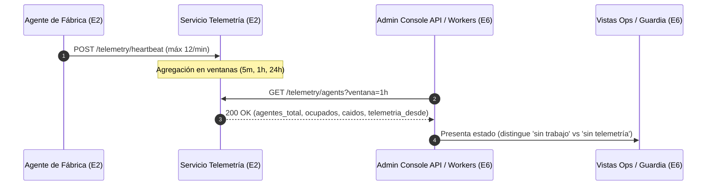

# Contrato de Telemetría del Pipeline de Producción (Equipo 2 ⇄ Equipo 6)

- **Versión del Contrato:** 1.1.0  
- **Fecha de Entrada en Vigor:** 11 de Noviembre de 2026  
- **Emisor (Productor):** Equipo 2 — Fábrica de Software & Pipeline de Producción (`kallicode-backend` / `core`)  
- **Consumidor:** Equipo 6 — Consola de Administración y Operaciones (`kallicode-admin`)  
- **Referencias de Arquitectura:** §17.13 – §17.16, §18.24 – §18.26, ADM-G06  
- **Estado de Aprobación:** APROBADO por el Architecture Board  

---

## 1. Principio Rector y Límites Arquitectónicos

> **"E6 consume la telemetría y nunca interpreta ni duplica lógica del pipeline."**

1. **Responsabilidad de Producción (Equipo 2):**  
   El pipeline de software es el único responsable de determinar el estado operativo de los agentes, la salud de las colas, la degradación de proveedores LLM y las decisiones de escalado. Todos los cálculos, heurísticas y agregados temporales son emitidos de forma canónica hacia la API interna de telemetría.
2. **Responsabilidad de Administración (Equipo 6):**  
   La consola de administración actúa como consumidor estricto de solo lectura. Queda expresamente prohibido que E6 implemente lógica ad-hoc para deducir si un agente "está caído" o inventar contadores. Cualquier discrepancia o necesidad diagnóstica debe resolverse en este contrato canónico.
3. **Autenticación Inter-Servicio:**  
   La comunicación entre la consola y los endpoints de telemetría se realiza exclusivamente mediante tokens de servicio emitidos internamente (`typ="svc"`, `iss="admin-console"`, `aud="internal-telemetry"`), respetando el menor privilegio.

---

## 2. Endpoints Canónicos del Contrato v1.1

Base URL canónica interna: `http://localhost:8000/internal/v1/telemetry` (configurable vía `KC_ADMIN_TELEMETRY_BASE_URL`).



---

### 2.1. Endpoint 1: Latido de Agente (§17.13)

- **Ruta:** `POST /internal/v1/telemetry/heartbeat`
- **Descripción:** Emisión periódica de presencia y actividad de agentes individuales en cada línea y etapa de la fábrica de software.
- **Restricción de Tasa (Rate-Limit):**  
  **Máximo 12 latidos por minuto por agente** (un latido cada 5 segundos como mínimo). Emisiones con cadencia superior son rechazadas con HTTP 429 `RATE_LIMIT_EXCEDIDO`.

#### Payload de Solicitud (JSON):

```json
{
  "agente_id": "ag_build_01M76AA",
  "linea": "linea_03",
  "etapa": "build",
  "job_id": "job_991823",
  "ventana_s": 5,
  "timestamp": "2026-11-11T20:15:00.000Z"
}
```

#### Campos Requeridos:
- `agente_id` (string, max 64): Identificador determinista del agente en ejecución.
- `linea` (string, max 32): Identificador de la línea de producción asignada.
- `etapa` (string): Etapa canónica (`triage` | `design` | `build` | `qa` | `security` | `deploy`).
- `job_id` (string | null): Identificador del trabajo en curso, o `null` si el agente se encuentra ocioso / en espera.
- `ventana_s` (integer, 1 a 60): Ventana de tiempo cubierta por el latido en segundos.
- `timestamp` (string ISO-8601 UTC): Marca de tiempo precisa de emisión del latido.

#### Respuesta Esperada:
- `202 Accepted`: Latido recibido y encolado en el agregador.
- `422 Unprocessable Entity`: Esquema inválido o etapa no reconocida.
- `429 Too Many Requests`: Superación de 12 latidos/minuto por agente.

---

### 2.2. Endpoint 2: Estado Agregado de Agentes y Líneas (§17.14)

- **Ruta:** `GET /internal/v1/telemetry/agents`
- **Descripción:** Provee el estado agregado consolidado de agentes, ocupación y líneas de la fábrica para supervisión operativa en `OpsAgents.tsx`.
- **Parámetros de Consulta:**
  - `ventana` (string, opcional): Ventana temporal de agregación. Valores admitidos: `5m`, `1h` (valor por defecto), `24h`.
  - `etapa` (string, opcional): Filtro por etapa específica (`triage`, `design`, `build`, `qa`, `security`, `deploy`).

#### Payload de Respuesta (JSON):

```json
{
  "ventana": "1h",
  "telemetria_desde": "2026-11-11T20:14:55.000Z",
  "agentes_total": 25,
  "agentes_ocupados": 18,
  "agentes_caidos": 1,
  "jobs_completados": 142,
  "duracion_p95_s": 38.5,
  "lineas_activas": 12,
  "etapas": [
    {
      "etapa": "triage",
      "agentes_total": 4,
      "agentes_ocupados": 2,
      "agentes_caidos": 0,
      "en_cola": 5,
      "latencia_p95_ms": 1200,
      "errores": 0
    },
    {
      "etapa": "design",
      "agentes_total": 6,
      "agentes_ocupados": 5,
      "agentes_caidos": 0,
      "en_cola": 12,
      "latencia_p95_ms": 4800,
      "errores": 0
    },
    {
      "etapa": "build",
      "agentes_total": 10,
      "agentes_ocupados": 8,
      "agentes_caidos": 1,
      "en_cola": 18,
      "latencia_p95_ms": 14200,
      "errores": 1
    },
    {
      "etapa": "qa",
      "agentes_total": 5,
      "agentes_ocupados": 3,
      "agentes_caidos": 0,
      "en_cola": 2,
      "latencia_p95_ms": 6100,
      "errores": 0
    }
  ]
}
```

---

### 2.3. Endpoint 3: Salud y Estado de Colas del Pipeline (§17.15)

- **Ruta:** `GET /internal/v1/telemetry/queues`
- **Descripción:** Monitoreo de profundidad, congestión, mensajes no confirmados y Dead Letter Queues (DLQ) del sistema de mensajería asíncrona.
- **Parámetros de Consulta:**
  - `incluir_dlq` (boolean, opcional, por defecto `true`): Incluye el conteo y detalle de la cola de fallidos `kc:dlq`.

#### Payload de Respuesta (JSON):

```json
{
  "telemetria_desde": "2026-11-11T20:14:50.000Z",
  "resumen": {
    "criticas": 1,
    "atencion": 1,
    "pendientes_total": 104,
    "fallidos_total": 2
  },
  "colas": [
    {
      "nombre": "cola_ingesta",
      "profundidad": 24,
      "antiguedad_max_s": 15,
      "no_confirmados": 4,
      "dlq": 0,
      "umbral_atencion_s": 60,
      "estado": "normal"
    },
    {
      "nombre": "cola_generacion",
      "profundidad": 78,
      "antiguedad_max_s": 75,
      "no_confirmados": 12,
      "dlq": 0,
      "umbral_atencion_s": 60,
      "estado": "atencion"
    },
    {
      "nombre": "kc:dlq",
      "profundidad": 2,
      "antiguedad_max_s": 320,
      "no_confirmados": 0,
      "dlq": 2,
      "umbral_atencion_s": 0,
      "estado": "critico"
    }
  ]
}
```

#### Regla de Detección de Colas:
- La cola observada para descarte crítico y envenenamiento de mensajes es obligatoriamente **`kc:dlq`**.
- Cualquier mensaje retenido en `kc:dlq` marca la salud global como `critico`.

---

### 2.4. Endpoint 4: Estado de Proveedores, Modelos y Escalados (§17.16)

- **Ruta:** `GET /internal/v1/telemetry/providers`
- **Descripción:** Agregados de disponibilidad, latencias percentiles, tasa de error y escalado progresivo de inferencia LLM.
- **Parámetros de Consulta:**
  - `ventana` (string, opcional): `1h`, `24h` (por defecto), `7d`, `30d`.
  - `proveedor` (string, opcional): Filtro por nombre de proveedor (`google`, `anthropic`, etc.).

#### Payload de Respuesta (JSON):

```json
{
  "ventana": "24h",
  "telemetria_desde": "2026-11-11T20:14:40.000Z",
  "proveedores": [
    {
      "proveedor": "Google",
      "modelo": "gemini-2.5-flash",
      "tier": "flash",
      "disponibilidad_pct": 99.98,
      "latencia_p50_ms": 180,
      "latencia_p95_ms": 420,
      "tasa_error_pct": 0.05
    },
    {
      "proveedor": "Google",
      "modelo": "gemini-2.5-pro",
      "tier": "pro",
      "disponibilidad_pct": 99.85,
      "latencia_p50_ms": 650,
      "latencia_p95_ms": 1250,
      "tasa_error_pct": 0.12
    },
    {
      "proveedor": "Anthropic",
      "modelo": "claude-3-7-sonnet",
      "tier": "fable",
      "disponibilidad_pct": 99.92,
      "latencia_p50_ms": 920,
      "latencia_p95_ms": 1840,
      "tasa_error_pct": 0.08
    }
  ],
  "escalados": {
    "flash_a_pro": 142,
    "pro_a_fable": 18,
    "a_humano": 3
  }
}
```

#### Regla Innegociable de Tiers y Escalados:
- **Separación de `fable`:** El tier `fable` (modelos de razonamiento avanzado y síntesis de alta capacidad) **debe exponerse de forma estrictamente independiente de `pro`**. Queda prohibido colapsar `fable` dentro de `pro`.
- **Ruta de Escalado Oficial:**  
  $$\text{flash} \longrightarrow \text{pro} \longrightarrow \text{fable} \longrightarrow \text{a\_humano (fallback)}$$

---

## 3. Reglas Innegociables de Diagnóstico en Pantalla

Para prevenir falsos positivos y diagnósticos erróneos durante incidentes de guardia, el consumidor y el proveedor acuerdan tres estados unívocos:

| Estado Operativo | Condición Técnica | Interpretación Semántica | Comportamiento en UI / API |
|---|---|---|---|
| **Operativo Normal** | `agentes_total > 0` y `agentes_ocupados > 0` | Fábrica operando con carga de trabajo activa. | Indicador verde `EN VIVO`, renderizado completo de métricas. |
| **Sin Trabajo** | `agentes_total > 0` y `agentes_ocupados = 0` | **El sistema está sano pero no tiene carga de trabajo.** | Indicador `EN VIVO` activo, métricas en 0, **sin banner de error**. |
| **Sin Telemetría** | `agentes_total = 0` y `telemetria_desde = null` | **No existe señal de telemetría.** El pipeline no reporta. | Banner de advertencia `data-testid="banner-sin-telemetria"`, métricas en `null` (nunca ceros inventados). |
| **Pérdida de Señal** | Antigüedad del último latido $> 15\text{ min}$ (900 s) | **Telemetría desactualizada o caída.** | Rechazo con **HTTP 503 `TELEMETRIA_NO_DISPONIBLE`**. |

### Declaración de Falsos Ceros (§18.24):
> Si no hay telemetría disponible, los contadores de etapas se devuelven como `null`. **Prohibido devolver ceros numéricos**, ya que los ceros indican que hay agentes pero no tienen trabajo asignado.

---

## 4. Gobernanza, Retención y Acuerdos de Nivel de Servicio (SLA)

1. **SLA de Entrega de Eventos:**
   - La latencia máxima de agregación desde la emisión del latido en el agente hasta su disponibilidad en `/telemetry/agents` debe ser **menor a 5 minutos** ($< 300\text{ s}$).
2. **Política de Retención:**
   - Eventos brutos de heartbeat: retención efímera en Redis/Timescale de **24 horas**.
   - Agregados por ventana (`5m`, `1h`, `24h`): persistidos con retención de **90 días**.
3. **Mecanismo de Desconexión Rápida (Fail-Safe):**
   - Si el servicio de telemetría no responde en 3 segundos (`telemetry_timeout_s = 3.0`), la API de administración eleva HTTP 503 sin bloquear la ejecución de la consola.

---

## 5. Acta de Formalización y Firmas Conceptuales

El presente acuerdo ha sido auditado y aprobado como contrato oficial vinculante entre los equipos:

| Rol | Firmante Representante | Equipo / Área | Estado |
|---|---|---|---|
| **Tech Lead Fábrica** | FAB1 | Equipo 2 — Pipeline de Producción | ✅ Firmado |
| **Tech Lead Consola** | ADM1 | Equipo 6 — Consola de Administración | ✅ Firmado |
| **Árbitro Arquitectónico** | Architecture Board | KalliCode Platform Governance | ✅ Aprobado |
