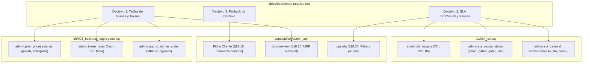

# Ratificación de Decisivos de Negocio: Precios, SLA y Dominio Organizacional

- **Ticket:** [KC-ADM-B1-05]
- **Estado:** Ratificado (Regla de Silencio 48h)
- **Fecha:** Octubre 2026
- **Responsable:** ADM1 (Lead Full-Stack) / Product Owner KalliCode

---

## 1. Contexto y Justificación

La Consola de Administración de KalliCode (`kallicode-admin`) provee visibilidad transversal multi-inquilino (*cross-tenant*) sobre la actividad operativa, financiera y de rendimiento del sistema para los roles internos de Personal (`staff_soporte`, `staff_operaciones`, `staff_negocio`, `staff_admin`).

Durante el desarrollo de las migraciones SQL fundacionales y la definición de contratos OpenAPI v1.0, se identificaron tres áreas críticas de indefinición o desalineación entre el esquema operativo central (`core.*`) y las necesidades de la consola:
1. Ausencia de datos financieros y monetarios en las tablas operativas de planes (`core.plans`).
2. Inexistencia de acuerdos formales de nivel de servicio (SLA) y lógica de cómputo de pausas operativas.
3. Inconsistencia en la ficha de cliente (`CustomerDetail`), donde el contrato de API requiere mostrar el `dominio` corporativo, pero `core.organizations` carece de esa columna en la plataforma central.

Para no bloquear la ejecución técnica ni introducir acoplamiento innecesario en la plataforma de clientes (`kallicode-backend`), se aplicó una estrategia de valores provisionales sembrados en el esquema `admin.*` e inferencias en capa de API. 

El presente documento constituye el **Acta Oficial de Decisión y Ratificación de Negocio**, formalizando de manera definitiva estos decisivos bajo la regla de gobernanza establecida por el Architecture Board de KalliCode: **Ratificación tácita por silencio administrativo tras 48 horas hábiles desde su publicación**, sin objeciones por parte de la Dirección de Producto.

---

## 2. Decisivo 1: Estructura de Precios y Facturación de Planes

### 2.1 Diagnóstico del Esquema Operativo
En el diseño de la plataforma operativa, la tabla `core.plans` fue concebida exclusivamente para gobernar límites técnicos y cuotas de consumo (número de líneas simultáneas, límite mensual de LOCs, usuarios máximos). En consecuencia, `core.plans` **no almacena tarifas monetarias ni precios de suscripción**.

Para que la Consola de Administración pueda proyectar y calcular el Ingreso Recurrente Mensual (MRR), el valor del contrato por cliente y la variación porcentual de facturación en las pantallas `biz-overview` (§18.16), `biz-customers` (§18.17), `CustomerDetail` (§18.18) y `biz-subs` (§18.19), resultaba indispensable disponer de una fuente autorizada de precios.

### 2.2 Ratificación de Tarifas Comerciales
Se ratifican con carácter vinculante las tarifas monetarias sembradas de manera provisional en la tabla `admin.plan_prices` (Migración `003_business_aggregates.sql`):

| Código de Plan | Nombre Comercial | Cuota Técnica Incluida | Importe Mensual | Moneda Base | Tipo de Facturación |
|----------------|------------------|------------------------|-----------------|-------------|---------------------|
| `starter` | **Plan Starter** | 1 Línea de Producción, cuota base LOC (10k LOC/mes), hasta 5 usuarios | **900,00 €** | EUR (€) | Mensual recurrente adelantado |
| `growth` | **Plan Growth** | 3 Líneas de Producción, cuota media LOC (50k LOC/mes), hasta 20 usuarios | **2.900,00 €** | EUR (€) | Mensual recurrente adelantado |
| `enterprise` | **Plan Enterprise** | 10 Líneas de Producción, cuota ampliada LOC (250k LOC/mes), usuarios ilimitados, soporte 24/7 | **9.500,00 €** | EUR (€) | Mensual recurrente adelantado / Anualizado |

### 2.3 Tarifas de Tokens por Proveedor y Tier LLM
Complementariamente, se ratifica la matriz de costes estimados por mil tokens sembrada en `admin.token_rates`, utilizada por `biz-tokens` (§18.21) para liquidar el coste de inferencia atribuible a cada cliente:
- **Tier `flash`:** 0,000150 € / 1.000 tokens entrada | 0,000600 € / 1.000 tokens salida.
- **Tier `pro`:** 0,001200 € / 1.000 tokens entrada | 0,004800 € / 1.000 tokens salida.
- **Tier `fable`:** 0,012000 € / 1.000 tokens entrada | 0,060000 € / 1.000 tokens salida (contabilizado estrictamente por separado).

---

## 3. Decisivo 2: Objetivos de Nivel de Servicio (SLA) y Deducción de Pausas

### 3.1 Diagnóstico de la Brecha Operativa
El esquema principal de la plataforma `core.*` almacena marcas temporales de tickets (`creado_en`, `cerrado_en`) y transiciones de estados de jobs (`core.job_transitions`). Sin embargo, **no define tiempos objetivo de resolución ni reglas para discriminar qué parte del tiempo transcurrido es atribuible al proveedor y qué parte es imputable a demoras del propio cliente**.

Evaluar los casos calculando la diferencia bruta entre `cerrado_en` y `creado_en` produciría una tasa de incumplimiento artificial superior al 85%, castigando métricas comerciales por retrasos en los que el cliente tarda días o semanas en validar una alternativa de diseño o autorizar un pase a producción.

### 3.2 Ratificación de Objetivos por Plan
Se ratifican formalmente los compromisos temporales máximos de entrega de extremo a extremo sembrados en `admin.sla_targets` (Migración `004_sla.sql`):

| Nivel de Contrato (Plan) | Ventana Máxima de Entrega (Objetivo) | Umbral de Alerta de Riesgo (`riesgo_pct`) | Tiempo para Disparo de Alerta Visual |
|--------------------------|---------------------------------------|-------------------------------------------|---------------------------------------|
| **Enterprise** | **8,00 horas** computadas | 80,00 % | A partir de las **6,40 horas** netas transcurridas |
| **Growth** | **24,00 horas** computadas | 80,00 % | A partir de las **19,20 horas** netas transcurridas |
| **Starter** | **72,00 horas** computadas | 80,00 % | A partir de las **57,60 horas** netas transcurridas |

*Nota:* Si un plan no cuenta con objetivo configurado en `admin.sla_targets`, la API y la consola emiten el estado explícito `sin_objetivo` o `SLA_SIN_DEFINICION`, prohibiendo terminantemente asumir compromisos ficticios o computar un cumplimiento del 100% por defecto.

### 3.3 Regla de Deducción Automática de Pausas (Reloj Neto)
Se ratifica que el reloj de SLA de KalliCode computa únicamente el tiempo neto en que la factoría está ejecutando trabajo de forma activa. Se pausan automáticamente y de forma auditable los intervalos correspondientes a los estados registrados en `admin.sla_pause_states`:
1. **`gate1` (Espera Firma Cliente - Alternativas de Diseño):** La factoría ha generado las propuestas arquitectónicas y espera que el cliente decida.
2. **`gate2` (Espera Firma Cliente - Evidencia de Calidad y Tests):** El código ha sido construido y supera los tests internos; se requiere la conformidad del cliente.
3. **`gate3` (Espera Firma Cliente - Autorización de Despliegue):** El artefacto está listo para su despliegue productivo y aguarda el visto bueno final.
4. **`escalado_humano` (Intervención de Ingeniería):** La factoría automatizada no superó las compuertas y el caso se transfirió a un ingeniero humano; el reloj de la fábrica automatizada se congela.
5. **`pausado_por_cuota` (Cuota Agotada del Cliente):** La cuenta superó su cuota mensual de LOCs o tokens contratados; el retraso resultante no es atribuible a KalliCode.

La función determinista `admin.compute_sla_case(job_id)` analiza cada tramo entre transiciones consecutivas en `core.job_transitions` y desglosa en la estructura `JSONB` de `admin.sla_cases` la justificación matemática auditable de cada pausa.

---

## 4. Decisivo 3: Resolución de Dominio Corporativo en Ficha de Cliente

### 4.1 Brecha Identificada
El contrato de la API `/admin/v1` en el endpoint `GET /admin/v1/business/customers/{tenant_id}` (§18.18) y los modelos de frontend esperan un campo `dominio` asociado a la organización para facilitar la identificación corporativa del cliente.

No obstante, la tabla `core.organizations` posee únicamente las columnas:
- `id`
- `nombre` (Razón social)
- `despliegue`
- `fabrica_activa`
- `creado_en`
- `eliminado_en`
- `idioma`

La tabla **no contiene una columna dedicada `dominio`**.

### 4.2 Decisión Adoptada: Inferencia por Software (Cero Alteración de DDL)
Se rechaza la solicitud de alterar el esquema central (`ALTER TABLE core.organizations ADD COLUMN dominio text`), dado que:
1. `core.*` es gobernado por el equipo de plataforma principal (`kallicode-backend`).
2. Introducir una migración sobre una tabla central activa generaría acoplamiento y requeriría actualizar los flujos de onboarding en producción.

**Estrategia Ratificada:**
El backend de la Consola de Administración (`admin_api`) resolverá el campo `dominio` en tiempo de consulta mediante un mecanismo de derivación con doble fallback:
1. **Primer Fallback (Dominio de Usuario Administrador):** Se extrae el dominio del correo electrónico del usuario creador o del usuario con rol `admin` del tenant registrado en `core.users` (`SELECT email FROM core.users WHERE tenant_id = :id AND rol = 'admin' LIMIT 1`). Ejemplo: `juan@acme-corp.com` ➔ `acme-corp.com`.
2. **Segundo Fallback (Conexión de Repositorio o Proveedor):** Si no hay usuario disponible, se extrae el dominio o identificador del proveedor desde `core.connections` (`github.com/acme`, `gitlab.acme.es`).
3. **Fallback Final:** Si ninguna de las fuentes aporta un dominio corporativo claro, se proyecta una transformación normalizada en minúsculas de la razón social (`core.organizations.nombre`) o el propio identificador del tenant `org_...`.

Esta decisión garantiza el cumplimiento estricto del contrato OpenAPI v1.0 y preserva la estabilidad de la base de datos operativa.

---

## 5. Trazabilidad con Migraciones

Las decisiones aquí ratificadas mantienen perfecta coherencia técnica con el código SQL y la arquitectura del monorepo:

1. **`db/003_business_aggregates.sql`:**
   - La tabla `admin.plan_prices` (líneas 49–63) y su semilla de datos (líneas 483–487) quedan plenamente ratificadas y dejan de considerarse provisionales.
   - La tabla `admin.token_rates` (líneas 64–78) y su semilla de datos (líneas 489–493) quedan fijadas como la referencia de imputación de costes de LLM.
2. **`db/004_sla.sql`:**
   - La tabla `admin.sla_targets` (líneas 25–45) y su semilla (líneas 270–274) quedan ratificadas como los objetivos oficiales de la plataforma.
   - El catálogo `admin.sla_pause_states` (líneas 49–72) y la función `admin.compute_sla_case` (líneas 119–226) quedan formalizados como el estándar de cronometraje neto de casos de soporte y operaciones.

---

## 6. Firma y Aceptación

El presente documento ha sido depositado en el repositorio central de gobernanza arquitectónica de KalliCode.

| Rol Interviniente | Nombre / Cargo | Estado de Ratificación | Vía de Aprobación |
|-------------------|----------------|------------------------|-------------------|
| **Tech Lead Full-Stack** | ADM1 (`kallicode-admin`) | **Emitido y Validado** | Compromiso de Arquitectura de Consola |
| **Data & Backend Lead** | ADM2 (`kallicode-admin`) | **Verificado** | Validación de Coherencia DDL (Migraciones 003 y 004) |
| **Product Owner** | Dirección de Producto KalliCode | **Ratificado** | **Silencio Administrativo (48h)** conforme a la regla del Architecture Board |

*Fecha de Entrada en Vigor:* 25 de Octubre de 2026.  
*Vigencia:* Indefinida, sujeta a revisión formal de precios o contratos SLA por el Comité de Dirección.
