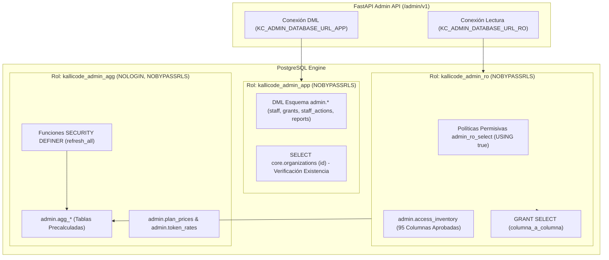
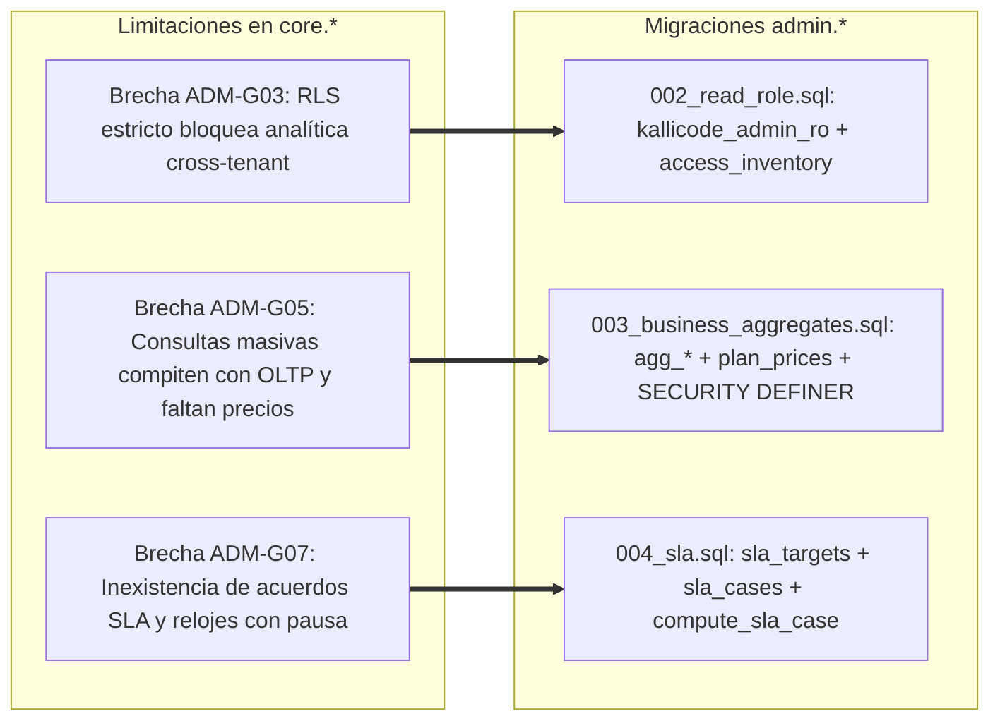

# Inventario de Fuentes de Datos y Brechas por Pantalla

**Consola de Administración KalliCode (`kallicode-admin`)**  
**Documento Maestro de Arquitectura de Datos y Trazabilidad**  
**Versión:** 1.2 (Congelada y Armonizada con Migraciones 001–004 y Contrato OpenAPI v1.0)  
**Ticket de Referencia:** `[KC-ADM-B1-03]` | **Épica:** EAD2 | **Responsable:** ADM2 (Backend & Datos)

---

## 1. Resumen Ejecutivo y Metodología Cross-Tenant

### 1.1 Propósito
Este documento constituye el inventario maestro de fuentes de datos de la Consola de Administración KalliCode (`kallicode-admin`). Establece la trazabilidad exhaustiva campo a campo para las 7 pantallas canónicas del Capítulo 18 de la especificación funcional y la vista de Ficha Detalle de Cliente (`CustomerDetail`), mapeándolas hacia las tablas operativas de la plataforma (`core.*`) y las estructuras analíticas del esquema de administración (`admin.*`). Asimismo, formaliza y justifica la necesidad arquitectónica de las migraciones SQL 002, 003 y 004, delimitando los requerimientos de índices analíticos y las políticas de enmascaramiento estricto de Información de Identificación Personal (PII).

### 1.2 Modelo de Seguridad y Triple Separación de Conexiones
A diferencia del backend operativo de clientes (`kallicode-backend`), la Consola de Administración requiere visibilidad global multi-inquilino (*cross-tenant*) para labores de soporte técnico, observabilidad operativa y liquidación de facturación. Para satisfacer esta necesidad sin vulnerar el principio de mínimo privilegio ni arriesgar la elusión de controles de acceso a nivel de fila (*Row Level Security*), la arquitectura implementa una separación estricta de tres roles de base de datos, ninguno de los cuales posee privilegios de superusuario ni elusión de RLS (`NOBYPASSRLS`):

1. **`kallicode_admin_app` (Conexión Operativa de la API):**
   - Utilizado por la API FastAPI para gestionar identidad de personal, sesiones, emisión de concesiones temporales, registro inmutable de auditoría y ejecución de reportes.
   - Privilegios: `USAGE` sobre esquemas `admin` y `core`. `SELECT, INSERT, UPDATE, DELETE` en tablas de `admin.*` (con excepción de `admin.staff_actions`, donde `UPDATE, DELETE, TRUNCATE` están revocados a nivel de privilegios y bloqueados por triggers).
   - Acceso a `core.*`: Estrictamente limitado a `GRANT SELECT (id) ON core.organizations` para verificar la existencia del tenant al generar solicitudes de concesión (§18.13). Tiene prohibido el acceso a cualquier otra tabla o columna de clientes.
2. **`kallicode_admin_ro` (Conexión de Lectura Analítica Cross-Tenant):**
   - Utilizado por los endpoints de visualización y consulta para alimentar las pantallas de soporte y administración.
   - Principio: `NOBYPASSRLS`. No elude las políticas RLS. El acceso se habilita mediante políticas permisivas explícitas `admin_ro_select` (`FOR SELECT TO kallicode_admin_ro USING (true)`) combinadas con concesiones `GRANT SELECT` acotadas **columna por columna**.
   - Ninguna columna fuera de la tabla de control `admin.access_inventory` puede ser consultada por este rol.
3. **`kallicode_admin_agg` (Rol de Agregación en Segundo Plano):**
   - Rol de servicio interno sin credenciales de acceso interactivo (`NOLOGIN`, `NOBYPASSRLS`).
   - Propietario de las funciones de refresco periódico configuradas como `SECURITY DEFINER` (`admin.refresh_customer_state`, `admin.refresh_usage_cycle`, `admin.refresh_tokens_daily`, `admin.refresh_pipeline_daily`, `admin.refresh_upgrade_requests`, `admin.refresh_sla`).
   - Encapsula el cálculo de métricas pesadas leyendo las columnas autorizadas de `core.*` y escribiendo exclusivamente en las tablas de agregado `admin.agg_*` y `admin.sla_cases`.

---

## 2. Matriz de Trazabilidad Campo a Campo para las 7 Pantallas y CustomerDetail

### 2.1 Pantalla 1: `biz-overview` — Panel General de Negocio (§18.16)
- **Endpoint Principal:** `GET /admin/v1/business/overview`
- **Roles Autorizados:** `staff_negocio`, `staff_admin`
- **Parámetros:** `periodo` (`mes_actual` | `mes_anterior` | `trimestre` | `ano`), `comparar_con` (`periodo_anterior` | `mismo_periodo_ano_anterior`)

| Bloque / Campo UI | Fuente de Datos Real | Columnas Accedidas | Naturaleza del Dato | Estrategia de Acceso / Mitigación de Brecha |
|-------------------|----------------------|--------------------|---------------------|---------------------------------------------|
| **clientes.activos** | `admin.agg_customer_state` | `fabrica_activa`, `eliminado_en`, `suscripcion_estado` | Agregado Precalculado | Derivado de `core.organizations` y `core.subscriptions`. Clientes con onboarding completado y suscripción activa. |
| **clientes.nuevos** | `admin.agg_customer_state` | `alta_el` | Agregado Precalculado | Conteo de organizaciones dadas de alta dentro de la ventana temporal seleccionada. |
| **clientes.perdidos** | `admin.agg_customer_state` | `finaliza_el`, `suscripcion_estado` | Agregado Precalculado | Suscripciones canceladas o finalizadas en el ciclo. |
| **clientes.por_plan** | `admin.agg_customer_state` | `plan_codigo` | Agregado Precalculado | Desglose agrupado por plan comercial (`starter`, `growth`, `enterprise`). |
| **ingreso_recurrente.importe** | `admin.agg_customer_state` + `admin.plan_prices` | `importe_mes`, `moneda` | Agregado Precalculado | **Brecha resuelta por Migración 003**: `core.plans` no almacena importes; se une con `admin.plan_prices`. |
| **ingreso_recurrente.variacion_pct** | `admin.agg_customer_state` | `importe_mes` | Cálculo Analítico | Comparativa porcentual contra el agregado del ciclo anterior. |
| **consumo.loc** | `admin.agg_usage_cycle` | `loc_consumidas` | Agregado Precalculado | Suma de líneas de código netas consumidas en el periodo según `core.usage_cycles`. |
| **consumo.tokens** | `admin.agg_usage_cycle` | `tokens_in`, `tokens_out` | Agregado Precalculado | Suma consolidada de tokens procesados por la factoría en el ciclo. |
| **consumo.coste_estimado** | `admin.agg_usage_cycle` + `admin.token_rates` | `coste`, `moneda` | Agregado Precalculado | **Brecha resuelta por Migración 003**: Coste ponderado calculado según tarifas de `admin.token_rates`. |
| **pipeline.tickets_entregados** | `admin.agg_pipeline_daily` | `tickets_entregados` | Agregado Precalculado | Casos con entrega final en producción dentro de la ventana (`core.tickets`). |
| **pipeline.tiempo_e2e_p50_h** | `admin.agg_pipeline_daily` | `tiempo_e2e_p50_h` | Agregado Estadístico | Percentil 50 de duración desde `creado_en` hasta `cerrado_en` en horas. |
| **pipeline.tiempo_e2e_p95_h** | `admin.agg_pipeline_daily` | `tiempo_e2e_p95_h` | Agregado Estadístico | Percentil 95 de duración de extremo a extremo. |
| **pipeline.escalados_humano** | `admin.agg_pipeline_daily` | `escalados_humano` | Agregado Precalculado | Transiciones registradas hacia el estado `escalado_humano` (`core.job_transitions`). |
| **frescura.*** | `admin.aggregate_state` | `refreshed_at`, `status` | Metadato de Control | Si `status = 'fallido'` o frescura supera umbral, la API emite `HTTP 503 AGREGADO_NO_DISPONIBLE`. |

---

### 2.2 Pantalla 2: `biz-customers` — Listado de Clientes (§18.17)
- **Endpoint Principal:** `GET /admin/v1/business/customers`
- **Roles Autorizados:** `staff_soporte`, `staff_negocio`, `staff_admin`
- **Parámetros:** `q` (búsqueda por tenant_id; por razón social exige concesión previa), `estado` (`activo` | `suspendido` | `moroso` | `baja`), `plan`, `orden`, `page`, `page_size`

| Campo UI | Fuente de Datos Real | Columnas Accedidas | Naturaleza del Dato | Política de Enmascaramiento / Sensibilidad |
|----------|----------------------|--------------------|---------------------|--------------------------------------------|
| **id** | `core.organizations` | `id` | Clave Pública | Identificador inmutable del tenant (`org_...`). No sensible. |
| **razon_social** | `core.organizations` | `nombre` | PII Empresarial | **Sensible (PII = true en inventario)**. Enmascarado por defecto: inicial visible seguida de asteriscos (`K•••••••• S.L.`). Revelación exige concesión `datos_negocio`. |
| **plan** | `core.subscriptions` + `core.plans` | `plan_codigo`, `nombre` | Comercial | No sensible. Nombre comercial del plan contratado. |
| **estado** | `core.subscriptions` | `estado` | Operativo / Comercial | No sensible (`activo`, `suspendido`, `moroso`, `baja`). |
| **lineas_contratadas** | `core.plans` | `lineas` | Contractual | No sensible. Número de líneas de producción simultáneas contratadas. |
| **lineas_activas** | `core.production_lines` | `estado = 'ocupada'` | Estado Operativo | Conteo de líneas ocupadas procesando jobs en tiempo real. |
| **consumo_ciclo** | `admin.agg_usage_cycle` | `loc_consumidas`, `cuota_pct` | Métrica de Consumo | Porcentaje de la cuota del mes consumida y líneas brutas acumuladas. |
| **ultima_actividad** | `core.tickets` / `core.jobs` | `creado_en`, `actualizado_en` | Timestamp Operativo | Fecha y hora del evento más reciente del tenant en la plataforma. |
| **acciones** | Lógica de Control de UI | N/A | Interfaz | Botón «Ver Ficha» y botón «Solicitar Revelación Justificada». |

---

### 2.3 Pantalla 3: `CustomerDetail` — Ficha Integral 360° del Cliente (§18.18)
- **Endpoint Principal:** `GET /admin/v1/business/customers/{tenant_id}`
- **Roles Autorizados:** `staff_soporte`, `staff_negocio`, `staff_admin`
- **Control de Acceso Especial:** Ciertas subsecciones (usuarios, integraciones) exigen concesiones activas específicas (`datos_negocio` o `datos_tecnicos`).

| Sección / Bloque Ficha | Campo Específico | Fuente de Datos Real | Columnas Accedidas | Política de Enmascaramiento y Concesión |
|------------------------|------------------|----------------------|--------------------|------------------------------------------|
| **Identidad Organización** | Razón Social | `core.organizations` | `nombre` | Enmascarado salvo concesión activa `datos_negocio`. |
| | Modalidad Despliegue | `core.organizations` | `despliegue` | `cloud`, `on_premises`, `hibrido`. No sensible. |
| | Idioma Preferido | `core.organizations` | `idioma` | Código ISO de idioma. No sensible. |
| | Estado Onboarding | `core.organizations` | `fabrica_activa` | Booleano que certifica finalización de setup. |
| | Fecha de Alta | `core.organizations` | `creado_en` | Timestamp de registro en plataforma. |
| **Suscripción y Cuotas** | Plan y Ciclo Vigente | `core.subscriptions` | `plan_codigo`, `estado` | Código del plan y vigencia comercial. |
| | Ventana de Contrato | `core.subscriptions` | `inicia_el`, `renueva_el`, `finaliza_el` | Fechas límite del ciclo y aniversario de facturación. |
| | Cuota Asignada | `core.plans` | `loc_mes`, `max_usuarios`, `lineas` | Cuotas contractuales de líneas de código y usuarios. |
| | Importe Mensual | `admin.plan_prices` | `importe_mes`, `moneda` | Tarifa vigente del plan (aportada por Migración 003). |
| **Líneas de Producción** | Número y Estado | `core.production_lines` | `numero`, `estado` | Estados: `libre`, `ocupada`, `mantenimiento`. |
| **Histórico de Consumo** | Desglose 13 Meses | `admin.agg_usage_cycle` | `ciclo`, `loc_consumidas`, `umbral`, `cuota_pct`, `coste` | Serie mensual de líneas consumidas, % de cuota y coste atribuido. |
| **Usuarios del Cliente** | Nombre Completo | `core.users` | `nombre` | **Sensible (PII = true)**. Enmascarado salvo concesión `datos_negocio`. |
| | Rol y Estado | `core.users` | `rol`, `estado` | Rol corporativo del usuario (`admin`, `dev`) y estado. |
| | Última Actividad | `core.users` | `ultimo_acceso` | Marca temporal de último login en el portal. |
| **Integraciones** | Nombre Conexión | `core.connections` | `nombre` | **Sensible (PII = true)**. Puede revelar repositorios o dominios privados. |
| | Proveedor y Tipo | `core.connections` | `proveedor`, `categoria` | Categoría (`vcs`, `ci`, `issue_tracker`) y proveedor (`github`, `gitlab`). |
| | Salud Conexión | `core.connections` | `estado`, `ultimo_test` | Estado de enlace y fecha de última verificación exitosa. |
| **Documentación Alta** | Tipo y Estado Docs | `core.onboarding_documents` | `tipo_documento`, `estado`, `creado_en` | Tipos documentales aportados (arquitectura, requerimientos). |
| **Modal de Revelación** | Justificación / Firma | `admin.access_grants` | `justificacion`, `valido_hasta` | Modal de revelación con justificación ≥10 chars registrada en `staff_actions`. |

---

### 2.4 Pantalla 4: `biz-subs` — Gestión de Suscripciones y Upgrades (§18.19–18.20)
- **Endpoints:** `GET /admin/v1/business/subscriptions`, `GET /admin/v1/business/upgrade-requests`
- **Roles Autorizados:** `staff_negocio`, `staff_admin`
- **Parámetros:** `estado`, `renueva_en_dias` (filtro de renovación ≤30 días), `page`, `page_size`

| Pestaña / Vista | Campo UI | Fuente de Datos Real | Columnas Accedidas | Detalle de Operación y Lógica |
|-----------------|----------|----------------------|--------------------|-------------------------------|
| **Suscripciones Activas** | `tenant_id` | `core.subscriptions` | `tenant_id` | Identificador del cliente. |
| | `razon_social` | `core.organizations` | `nombre` | Enmascarado por defecto. |
| | `plan_vigente` | `core.subscriptions` | `plan_codigo` | Plan actual del suscriptor. |
| | `estado` | `core.subscriptions` | `estado` | Estado administrativo (`activa`, `morosa`, `cancelada`). |
| | `inicia_el` / `renueva_el` | `core.subscriptions` | `inicia_el`, `renueva_el` | Intervalo del periodo facturable actual. |
| | `cuota_uso_pct` | `admin.agg_usage_cycle` | `cuota_pct` | % de LOCs consumidas en el ciclo actual. |
| **Por Renovar (≤30d)** | `dias_para_renovacion` | `core.subscriptions` | `renueva_el` | Cálculo dinámico: `renueva_el - current_date`. Alerta si ≤30 días. |
| | `importe_proyectado` | `admin.plan_prices` | `importe_mes` | Importe recurrente estimado de renovación. |
| **Solicitudes de Upgrade** | `solicitud_id` | `core.upgrade_requests` | `id` | Identificador único de la petición comercial. |
| | `plan_actual` | `core.subscriptions` | `plan_codigo` | Plan contratado al momento de solicitar cambio. |
| | `plan_deseado` | `core.upgrade_requests` | `plan_deseado` | Plan al que el cliente desea transicionar. |
| | `urgente` | `core.upgrade_requests` | `urgente` | Flag booleano de alta prioridad comercial. |
| | `comentario` | `core.upgrade_requests` | `comentario` | **Sensible (PII = true)**: Texto libre del cliente. Enmascarado por defecto. |
| | `estado` | `core.upgrade_requests` | `estado` | Estados: `registrada`, `en_gestion`, `aplicada`, `descartada`. |
| | `antiguedad_h` | `core.upgrade_requests` | `creado_en` | Horas transcurridas desde la solicitud. |

---

### 2.5 Pantalla 5: `biz-tokens` — Análisis de Consumo de Tokens y Costes (§18.21)
- **Endpoint Principal:** `GET /admin/v1/business/usage/tokens`
- **Roles Autorizados:** `staff_negocio`, `staff_admin`
- **Parámetros:** `ciclo` (YYYY-MM), `tenant_id` (opcional), `agrupar_por` (`cliente` | `tier` | `dia`), `orden`

| Dimensión / Visualización | Campo UI | Fuente de Datos Real | Columnas Accedidas | Lógica de Procesamiento y Costeo |
|---------------------------|----------|----------------------|--------------------|-----------------------------------|
| **Agrupación Temporal (Día)** | `dia` | `admin.agg_tokens_daily` | `dia` | Fecha dentro del ciclo de facturación. |
| | `tokens_entrada` | `admin.agg_tokens_daily` | `tokens_in` | Suma de prompt tokens procesados. |
| | `tokens_salida` | `admin.agg_tokens_daily` | `tokens_out` | Suma de completion tokens generados. |
| | `coste_dia` | `admin.agg_tokens_daily` | `coste` | Coste estimado diario computado contra `admin.token_rates`. |
| **Desglose por Tier** | `tier` | `admin.agg_tokens_daily` / `core.llm_steps` | `tier` | Tiers oficiales: `flash`, `pro`, `fable`. |
| | `tokens_flash` | `admin.agg_usage_cycle` | `tokens_flash` | Volumen de tokens en tier rápido/económico. |
| | `tokens_pro` | `admin.agg_usage_cycle` | `tokens_pro` | Volumen de tokens en tier estándar de razonamiento. |
| | `tokens_fable` | `admin.agg_usage_cycle` | `tokens_fable` | **Tier crítico**: Modelo especializado de alta capacidad; se audita y costea por separado. |
| **Tabla por Cliente** | `tenant_id` | `admin.agg_usage_cycle` | `tenant_id` | Identificador de organización. |
| | `razon_social` | `core.organizations` | `nombre` | Razón social (enmascarada por defecto). |
| | `loc_netas` | `core.usage_loc` | `netas`, `tipo` | Líneas netas entregadas en pull requests cerrados. |
| | `coste_total_cliente` | `admin.agg_usage_cycle` | `coste`, `moneda` | Coste atribuido según matriz de tarifas. |
| **Integridad y Exportación** | `cuadra_con_facturacion` | Comparador de Ciclo | `loc_consumidas` vs `loc_mes` | Flag de coherencia entre consumo de líneas y cuota contratada. |
| | Reporte Descargable | `admin.reports` | `id`, `tipo`, `parametros` | `POST /admin/v1/business/reports` (CSV o PDF de liquidación). |

---

### 2.6 Pantalla 6: `ops-agents` — Estado de Agentes, Líneas y Colas (§18.24–18.25)
- **Endpoints Combinados:** `GET /admin/v1/ops/agents`, `GET /admin/v1/ops/queues`
- **Roles Autorizados:** `staff_operaciones`, `staff_admin`
- **Parámetros:** `ventana` (`5m` | `1h` | `24h`), `etapa`

| Sección UI | Elemento / Métrica | Fuente de Datos Real | Columnas Accedidas | Regla Operativa y Tratamiento |
|------------|--------------------|----------------------|--------------------|--------------------------------|
| **Salud de Telemetría** | `telemetria.disponible` | Inferencia de señal | `max(core.jobs.actualizado_en)` | Si no hay actividad en la ventana o worker no reporta, emite `false`. |
| | `telemetria.antiguedad_s`| Cálculo temporal | `clock_timestamp() - max(actualizado_en)` | Segundos de desfase del último pulso de telemetría de fábrica. |
| **Líneas de Producción** | `lineas.activas` | `core.production_lines` | `count(*) WHERE estado = 'ocupada'` | Líneas de trabajo generando código en paralelo. |
| | `lineas.mantenimiento` | `core.production_lines` | `count(*) WHERE estado = 'mantenimiento'` | Líneas detenidas por intervención técnica o fallas. |
| | `lineas.libres` | `core.production_lines` | `count(*) WHERE estado = 'libre'` | Capacidad disponible en la fábrica. |
| **Agentes en Fábrica** | `etapas[].agentes_total` | `core.jobs` | `estado`, `linea` | Conteo de instancias de pipeline por etapa operativa. |
| | `agentes_ocupados` | `core.jobs` | `estado IN ('build','qa','security')` | Agentes ejecutando trabajo activo. |
| | `agentes_caidos` | `core.job_transitions` | `a_estado = 'fallo'` | Agentes con abortos de ejecución no recuperados. |
| **Profundidad de Colas** | `colas[].pendientes` | `core.jobs` | `estado = 'pendiente_asignacion'` | Trabajos en espera de línea disponible. |
| | `antiguedad_max_s` | `core.jobs` | `min(creado_en) WHERE estado = 'pendiente'` | Tiempo en segundos del job más antiguo en cola. |
| | `estado_cola` | Clasificación Umbral | Dinámico según latencia de cola | Estados: `normal` (<60s), `atencion` (60–300s), `critico` (>300s). |
| **Regla de Ausencia** | Fallo de Telemetría | Indicador Transversal | N/A | Si `telemetria.disponible = false`, **anular contadores** y presentar advertencia explícita en lugar de ceros ficticios. |

---

### 2.7 Pantalla 7: `ops-models` — Telemetría de Modelos LLM y Servicios (§18.26, §18.31)
- **Endpoints Combinados:** `GET /admin/v1/ops/models`, `GET /admin/v1/health`
- **Roles Autorizados:** `staff_operaciones`, `staff_negocio`, `staff_admin`
- **Parámetros:** `ventana` (`1h` | `24h` | `7d` | `30d`), `proveedor`

| Bloque UI | Métrica / Campo | Fuente de Datos Real | Columnas Accedidas | Estrategia de Acceso / Agregación |
|-----------|-----------------|----------------------|--------------------|-----------------------------------|
| **Salud de Modelos** | `proveedor` / `modelo` | `core.llm_steps` / `admin.agg_tokens_daily` | `modelo`, `tier` | Identificador del proveedor y modelo (`anthropic`, `google`, `openai`). |
| | `latencia_p50_ms` | `admin.agg_tokens_daily` | `duracion_p50` | Percentil 50 de latencia de inferencia en milisegundos. |
| | `latencia_p95_ms` | `admin.agg_tokens_daily` | `duracion_p95` | Percentil 95 de latencia (detección de degradaciones). |
| | `disponibilidad_pct` | `admin.agg_tokens_daily` | `invocaciones`, `errores` | Cálculo: `((invocaciones - errores) / invocaciones) * 100`. |
| | `tasa_error_pct` | `core.llm_steps` | `validacion` | % de llamadas donde `validacion <> 'ok'` (errores de esquema o timeout). |
| **Escalados entre Tiers** | `escalados.flash_a_pro` | `core.llm_steps` | `reintentos`, `tier` | Fallos en flash que requirieron reintento automático en tier pro. |
| | `escalados.pro_a_fable` | `core.llm_steps` | `reintentos`, `tier` | Casos complejos escalados al modelo fable. |
| | `escalados.a_humano` | `core.job_transitions` | `a_estado = 'escalado_humano'` | Tickets donde la IA no logró superar las compuertas de calidad. |
| **Salud de Servicios** | `dependencias.postgres` | Sonda de Conexión | `SELECT 1` | Verificación del pool de conexiones PostgreSQL. |
| | `dependencias.redis` | Sonda de Ping | `redis.ping()` | Estado del clúster de caché, sesiones y revocación JWT. |
| | `dependencias.agregados`| `admin.aggregate_state` | `status`, `refreshed_at` | Verificación de frescura de las tablas analíticas. |

---

### 2.8 Pantalla Asociada: `ops-sla` — Cumplimiento de Niveles de Servicio (§18.27–18.28)
- **Endpoints:** `GET /admin/v1/ops/sla`, `GET /admin/v1/ops/sla/cases/{job_id}`
- **Roles Autorizados:** `staff_operaciones`, `staff_negocio`, `staff_admin`
- **Parámetros:** `periodo` (`mes_actual` | `mes_anterior`), `plan`

| Elemento UI / Vista | Campo Mapeado | Fuente de Datos Real | Columnas Accedidas | Regla de Negocio y Cálculo de Pausa |
|---------------------|---------------|----------------------|--------------------|-------------------------------------|
| **Objetivos por Plan** | `objetivo_h` | `admin.sla_targets` | `plan_codigo`, `etapa`, `objetivo_h` | **Brecha resuelta por Migración 004**: Starter: 72h, Growth: 24h, Enterprise: 8h. |
| | `riesgo_pct` | `admin.sla_targets` | `riesgo_pct` | Umbral (default 80%) para marcar caso como `en_riesgo`. |
| **Panel de Cumplimiento** | `cumplimiento_pct` | `admin.sla_cases` | `resultado` | % de casos finalizados con `resultado = 'dentro'`. |
| | `incumplidos` / `en_riesgo` | `admin.sla_cases` | `resultado` | Conteo de casos que violaron o amenazan violar el SLA. |
| **Listado de Casos** | `job_id` / `ticket_id` | `admin.sla_cases` | `job_id`, `ticket_id` | Identificadores técnicos del trabajo. |
| | `ticket_numero` | `core.tickets` | `numero` | **Sensible (PII = true)**: Correlativo visible de cliente. |
| | `tiempo_bruto_h` | `admin.sla_cases` | `bruto_h` | Tiempo total transcurrido desde creación hasta cierre. |
| | `tiempo_computado_h`| `admin.sla_cases` | `transcurrido_h` | **Tiempo neto imputable**: Bruto menos tramos pausados. |
| | `resultado` | `admin.sla_cases` | `resultado` | `dentro`, `incumplido`, `en_curso`, `en_riesgo`, `sin_objetivo`. |
| **Desglose del Reloj** | `tramos[]` | `admin.sla_cases` | `tramos` (JSONB) | Lista de intervalos `{inicio, fin, etapa, computa, causa_pausa, horas}`. |
| **Causas de Pausa** | `admin.sla_pause_states` | `estado_job`, `motivo` | Pausas por: `gate1`, `gate2`, `gate3` (espera de firma cliente), `pausado_por_cuota`, `escalado_humano`. |
| **Garantía de Reproducibilidad** | Función Determinista | `admin.compute_sla_case(job_id)` | `core.job_transitions` | Reconstruye con exactitud milimétrica el reloj sin ambigüedades. |

---

## 3. Análisis de Brechas Arquitectónicas y Justificación de Migraciones

La base de datos operativa de la plataforma (`core.*`) fue concebida exclusivamente para servir el portal del cliente con estricto aislamiento por organización. Para habilitar la Consola de Administración sin comprometer la integridad ni la estabilidad del sistema principal, se diseñaron y ejecutaron tres migraciones clave en el esquema `admin.*`:

### 3.1 Brecha 1 (ADM-G03) ➔ Resuelta por `db/002_read_role.sql`
- **Problema en `core.*`:** Cada tabla del esquema `core.*` posee políticas forzadas de *Row Level Security* vinculadas a `core.current_tenant()`. Conectar la consola administrativa mediante un usuario superadministrador o un rol con bandera `BYPASSRLS` crearía un agujero de seguridad inaceptable: cualquier consulta errónea o vulnerabilidad de inyección en la API expondría toda la base de datos de los clientes sin barreras.
- **Solución Implementada:**
  1. Creación del rol de base de datos `kallicode_admin_ro` configurado explícitamente con `NOBYPASSRLS NOSUPERUSER`.
  2. Implementación de la tabla de auditoría `admin.access_inventory`, que cataloga las ~95 columnas autorizadas de `core.*` junto a su justificación técnica y clasificación de privacidad.
  3. Adición de políticas RLS permisivas dedicadas `admin_ro_select` (`FOR SELECT TO kallicode_admin_ro USING (true)`), combinadas exclusivamente con privilegios `GRANT SELECT (columna)` a nivel de atributo.
  4. Función de verificación de barrera `admin.validate_read_role()`, ejecutada en cada inicio de la aplicación y en los pipelines de CI para asegurar que no existan columnas accesibles fuera del inventario aprobado ni privilegios residuales de escritura (`V1` a `V6`).

### 3.2 Brecha 2 (ADM-G05) ➔ Resuelta por `db/003_business_aggregates.sql`
- **Problema en `core.*`:**
  1. *Contención y Latencia:* Las tablas operativas de `core.*` están indexadas con `tenant_id` como clave líder para optimizar el acceso de clientes individuales. Ejecutar cálculos analíticos globales (MRR total, suma de cientos de millones de tokens, series diarias de pipeline) en tiempo real ejecutaría escaneos secuenciales masivos compitiendo directamente por memoria y bloqueos con el tráfico productivo.
  2. *Ausencia de Datos Financieros:* `core.plans` únicamente almacena cuotas técnicas (líneas de código, usuarios), careciendo de precios monetarios. Asimismo, la plataforma no dispone de un catálogo de tarifas por proveedor de LLM.
- **Solución Implementada:**
  1. Creación de las tablas de configuración económica `admin.plan_prices` (importe mensual y moneda por plan) y `admin.token_rates` (tarifas de entrada y salida por mil tokens para tiers `flash`, `pro` y `fable`).
  2. Creación de las tablas analíticas precalculadas: `admin.agg_customer_state`, `admin.agg_usage_cycle`, `admin.agg_tokens_daily`, `admin.agg_pipeline_daily` y `admin.agg_upgrade_requests`.
  3. Adopción de funciones `SECURITY DEFINER` pertenecientes al rol interno `kallicode_admin_agg` (`NOLOGIN`). Esto desacopla el privilegio de agregación del rol de la API y evita los problemas de permisos de las vistas materializadas tradicionales.
  4. Tabla de control de frescura `admin.aggregate_state`. Si un cálculo analítico falla o está desactualizado, la API devuelve `HTTP 503 AGREGADO_NO_DISPONIBLE` en lugar de datos caducos o inconsistentes.

### 3.3 Brecha 3 (ADM-G07) ➔ Resuelta por `db/004_sla.sql`
- **Problema en `core.*`:** La plataforma no cuenta con tablas ni lógica para modelar compromisos contractuales de servicio (SLA). Calcular el tiempo de resolución simplemente restando `terminado_en - creado_en` penalizaría al proveedor por el tiempo en que un caso estuvo detenido a la espera de aprobación de diseño del cliente (Gate 1), revisión de calidad (Gate 2), autorización de despliegue (Gate 3) o suspensión por superación de cuota.
- **Solución Implementada:**
  1. Creación de `admin.sla_targets` formalizando los compromisos de entrega según plan comercial (`starter`: 72h, `growth`: 24h, `enterprise`: 8h) y el umbral de alerta de riesgo (`riesgo_pct = 80%`).
  2. Creación del catálogo dinámico de pausas justificadas `admin.sla_pause_states` (`gate1`, `gate2`, `gate3`, `escalado_humano`, `pausado_por_cuota`).
  3. Creación de la tabla `admin.sla_cases` con almacenamiento en formato `JSONB` de los tramos cronometrados y sus motivos de pausa.
  4. Función `admin.compute_sla_case(job_id)`, que analiza cronológicamente las transiciones de estado en `core.job_transitions` para descontar con total reproducibilidad los intervalos en que la responsabilidad estuvo en manos del cliente.

---

## 4. Matriz de Privacidad, PII y Política de Enmascaramiento

### 4.1 Inventario de Columnas Sensibles y PII
Conforme a la tabla de control `admin.access_inventory`, exactamente 5 columnas del esquema `core.*` han sido clasificadas como información sensible y requieren protección criptográfica y enmascaramiento activo:

| Tabla de Origen | Columna Afectada | Clasificación | Justificación de la Clasificación | Pantallas Afectadas |
|-----------------|------------------|---------------|-----------------------------------|---------------------|
| `core.organizations` | `nombre` | PII Empresarial | Razón social y nombre de la empresa cliente. | `biz-customers`, `CustomerDetail`, `biz-subs`, `biz-tokens` |
| `core.users` | `nombre` | PII Persona Física | Nombre y apellidos de los usuarios del cliente. | `CustomerDetail` |
| `core.connections` | `nombre` | Información Confidencial | Nombre de la integración asignado por el cliente; puede revelar nombres de repositorios privados o infraestructura interna. | `CustomerDetail` |
| `core.upgrade_requests` | `comentario` | Contenido Libre Sensible | Texto libre redactado por el cliente con explicaciones comerciales o técnicas de su necesidad de escalado. | `biz-subs` |
| `core.tickets` | `numero` | Identificador de Negocio | Número correlativo visible que identifica los proyectos o tareas del cliente. | `ops-sla` |

### 4.2 Política de Enmascaramiento por Defecto
1. **Regla General:** Todos los endpoints de `/admin/v1` entregan los campos sensibles precedentemente listados enmascarados de forma predeterminada para cualquier rol del personal (`staff_soporte`, `staff_operaciones`, `staff_negocio`, `staff_admin`).
2. **Algoritmo de Enmascaramiento:**
   - Para cadenas de texto y nombres: Se preserva el primer carácter (o inicial) y se reemplaza el resto por caracteres de bloqueo o viñetas (ejemplo: `A•••••••• B.V.` o `K•••••••• S.L.`).
   - Para correos electrónicos: Se muestra la inicial del buzón, asteriscos y el dominio enmascarado (ejemplo: `j•••••@c••••••.com`).
   - Para comentarios de texto libre: Se trunca a texto bloqueado `[CONTENIDO PROTEGIDO - SOLICITAR REVELACIÓN]`.

### 4.3 Protocolo de Revelación Justificada y Auditoría Inmutable
Para desenmascarar datos protegidos durante una sesión de soporte o auditoría, se aplica el siguiente flujo obligatorio:
1. **Existencia de Concesión Activa:** El personal debe contar con una concesión vigente en `admin.access_grants` para el `tenant_id` específico y el tipo de dato requerido (`datos_negocio` o `datos_tecnicos`).
2. **Justificación Obligatoria:** Toda solicitud de revelación exige la introducción de un motivo documentado con una longitud mínima de 10 caracteres significativos.
3. **Registro Inmutable en `admin.staff_actions`:** La acción se inserta en la tabla de auditoría append-only `admin.staff_actions`, sellando el registro mediante un hash criptográfico encadenado (HMAC/SHA-256) que previene la manipulación o borrado de la traza de auditoría.
4. **Expiración Automática:** Las concesiones son temporales y caducan automáticamente tras su vigencia asignada (máximo 8 horas), retornando inmediatamente al estado enmascarado.

---

## 5. Requerimientos de Índices Cross-Tenant sobre `core.*`

Para evitar que las consultas analíticas del rol `kallicode_admin_ro` y los procesos de refresco de `kallicode_admin_agg` ejecuten costosos escaneos secuenciales (*Seq Scans*) en las tablas operativas de la plataforma, se formaliza el siguiente catálogo de índices requeridos sobre el esquema `core.*`:

| Tabla de Plataforma (`core.*`) | Definición de Índice Recomendado | Pantallas / Agregados Beneficiados | Justificación Técnica de Rendimiento |
|--------------------------------|----------------------------------|------------------------------------|--------------------------------------|
| `core.tickets` | `CREATE INDEX IF NOT EXISTS core_tickets_creado_en_idx ON core.tickets (creado_en DESC);` | `biz-overview`, `ops-sla`, `agg_pipeline_daily` | Agiliza el filtrado temporal por rango de fechas de tickets creados sin requerir `tenant_id`. |
| `core.tickets` | `CREATE INDEX IF NOT EXISTS core_tickets_cerrado_en_idx ON core.tickets (cerrado_en DESC, etapa) WHERE cerrado_en IS NOT NULL;` | `biz-overview`, `agg_pipeline_daily` | Optimiza el cálculo de métricas de entrega y percentiles de duración de extremo a extremo. |
| `core.jobs` | `CREATE INDEX IF NOT EXISTS core_jobs_creado_en_idx ON core.jobs (creado_en DESC);` | `ops-agents`, `ops-sla`, `refresh_sla` | Localiza rápidamente los jobs generados en la ventana de observación (ej. últimas 24h/95d). |
| `core.jobs` | `CREATE INDEX IF NOT EXISTS core_jobs_estado_linea_idx ON core.jobs (estado, linea) WHERE terminado_en IS NULL;` | `ops-agents`, `/ops/queues` | Cálculo inmediato de profundidad de colas y líneas ocupadas en tiempo real. |
| `core.job_transitions` | `CREATE INDEX IF NOT EXISTS core_job_trans_job_creado_idx ON core.job_transitions (job_id, creado_en ASC);` | `ops-sla`, `compute_sla_case` | Permite la reconstrucción secuencial inmediata de los tramos cronometrados de un caso. |
| `core.job_transitions` | `CREATE INDEX IF NOT EXISTS core_job_trans_estado_fecha_idx ON core.job_transitions (creado_en DESC, a_estado);` | `ops-models`, `agg_pipeline_daily` | Cuantificación de eventos de escalado humano por fecha. |
| `core.llm_steps` | `CREATE INDEX IF NOT EXISTS core_llm_steps_fecha_tier_idx ON core.llm_steps (creado_en DESC, tier, modelo);` | `biz-tokens`, `ops-models`, `agg_tokens_daily` | Agrupación analítica de consumo de tokens y percentiles de latencia por tier y modelo. |
| `core.usage_tokens` | `CREATE INDEX IF NOT EXISTS core_usage_tokens_fecha_tier_idx ON core.usage_tokens (creado_en DESC, tier);` | `biz-tokens`, `agg_usage_cycle` | Filtrado rápido de consumo por ventana mensual para cálculo de ciclo. |
| `core.subscriptions` | `CREATE INDEX IF NOT EXISTS core_subs_renueva_el_idx ON core.subscriptions (renueva_el ASC) WHERE estado = 'activa';` | `biz-subs` | Permite listar suscripciones por vencer en ≤30 días sin escanear toda la tabla. |
| `core.upgrade_requests` | `CREATE INDEX IF NOT EXISTS core_upg_estado_fecha_idx ON core.upgrade_requests (estado, creado_en DESC);` | `biz-subs`, `agg_upgrade_requests` | Recuperación instantánea de solicitudes pendientes ordenadas por antigüedad. |

---

## 6. Conclusión y Estado de Implementación

Con la formalización de este documento, el ticket **`[KC-ADM-B1-03]`** queda completamente satisfecho:
1. Se ha establecido el mapeo exhaustivo campo a tabla/columna para las 7 pantallas del Capítulo 18 y la ficha `CustomerDetail`.
2. Se fundamenta matemáticamente y a nivel de diseño la necesidad innegociable de las migraciones `002_read_role.sql` (seguridad multi-inquilino sin BYPASSRLS), `003_business_aggregates.sql` (rendimiento analítico y catálogo de precios/tarifas) y `004_sla.sql` (relojes de servicio auditables con pausas en compuertas de usuario).
3. Se delimita la matriz estricta de columnas PII y la política de enmascaramiento por defecto.
4. Se declaran los requerimientos de índices analíticos sobre `core.*` para garantizar tiempos de respuesta sub-segundo en la Consola de Administración KalliCode.
